# Application gallery

Actual Windows captures of the VDO.Ninja WebRTC Bridge editor, recorded on
2026-10-13 and 2026-10-14 from the source builds reviewed in
[the validation report](../../docs/developer/ISSUE_PR_REVIEW_2026-10-13.md).
The first captures use the native VST3 test host, which loads the real plugin
and its controls. `gallery-demo` is an inactive example stream in those
captures. Actual Ableton and REAPER host captures and synthetic audio routing are shown
below. None of these images are mockups.

## Play


## Publish

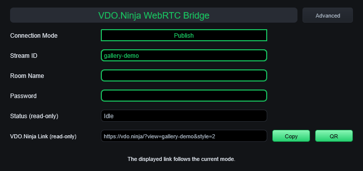

## Advanced settings

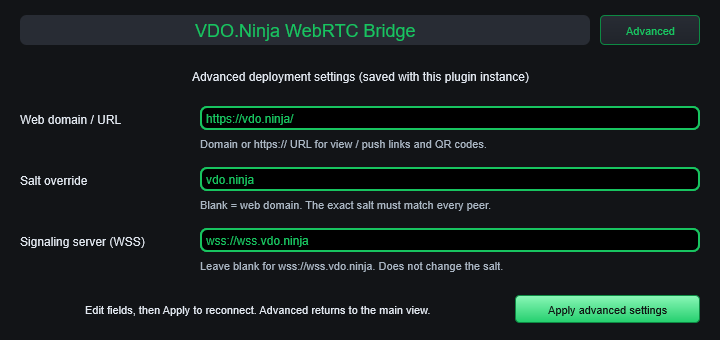

## Short recording

[Watch the native editor demonstration](editor-demo.mp4) (4.83 seconds, MP4, no audio).
The recording captures only the plugin window while the smoke test changes
views. It stops before the DPI scaling checks.

## Ableton Live 12.4.6

Windows trial, using its built-in mode with saving and exporting disabled.
The fixed complete bundle is running on an audio track with a second instance
that publishes the received synthetic test tone. These captures show routing
and editor behavior; see the [validation report](../../docs/developer/ISSUE_PR_REVIEW_2026-10-13.md#ableton-trial-follow-up)
for measured results and limits.

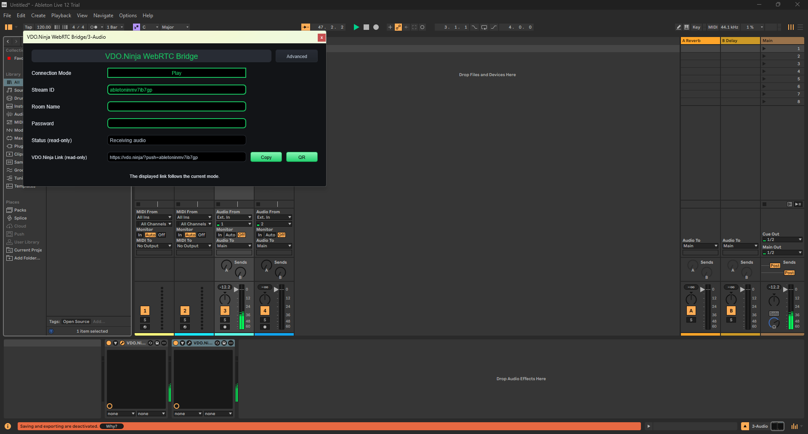

| Play | Publish |
| --- | --- |
| 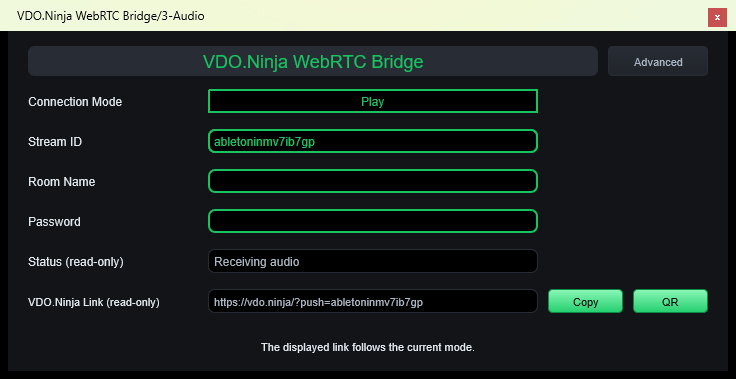 | 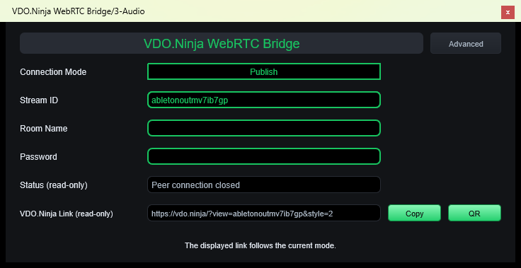 |

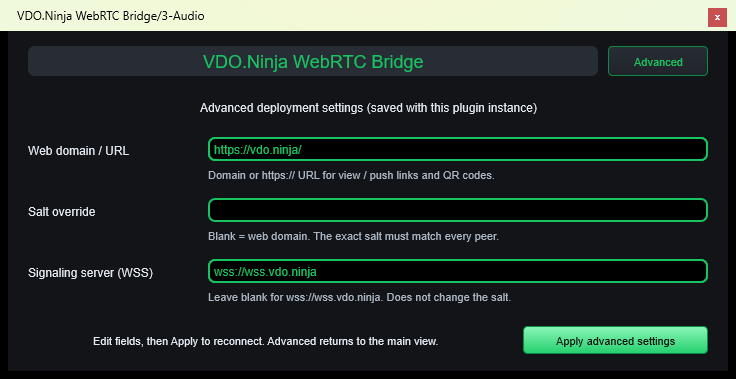

### Missing-resource regression

The complete released 0.2.5 bundle already displays normally in Live:

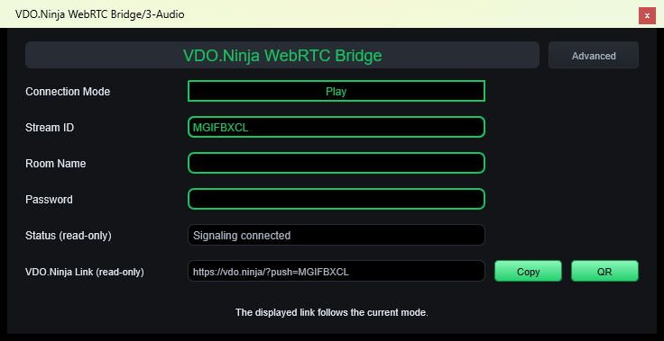

Copying only its inner binary produces this actual **42×39** outer window,
with a **26×0** client area and no usable controls:


The fixed binary alone restores the **720×340** editor even without the
external layout file. Installing the complete bundle is still recommended.


## REAPER 7.82

The final audio-fix build running in REAPER's Windows x64 evaluation on
2026-10-14. Both instances are on one track: a synthetic SDK sender feeds
Play, and Publish returns the received audio to an SDK sink. These captures
were taken during the passing 44.1 kHz / 512-sample Dummy Audio test, after
five editor open/close cycles per instance.

| Play | Publish |
| --- | --- |
| 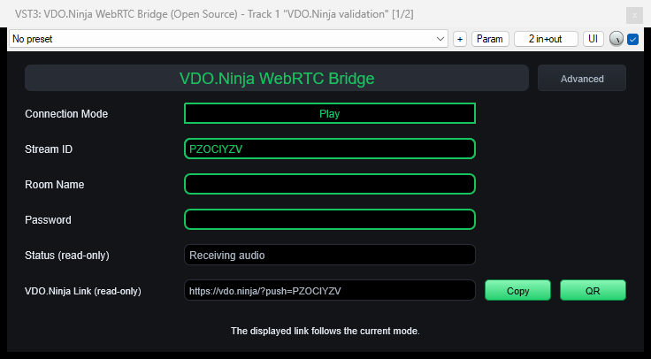 | 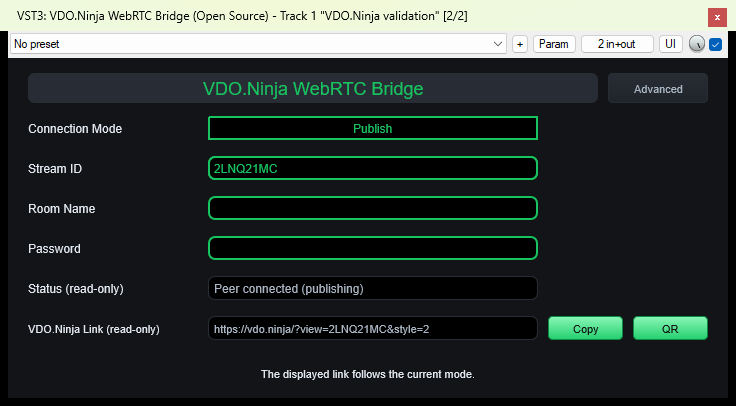 |

The [host validation report](../../docs/developer/ISSUE_PR_REVIEW_2026-10-13.md#reaper-core-vst-validation-2026-10-14)
also covers save/reload, a fresh host process, and offline rendering. Dummy
Audio exercises the real DAW/plugin graph without an audio interface.

## Audacity 3.7.9 — signed v0.2.6 package

The editor loaded from the signed Windows release ZIP on 2026-10-14.
Five open/close cycles and clean host shutdown passed. An owned synthetic
stream was configured; this capture shows the idle editor and does not
demonstrate Audacity audio playback.

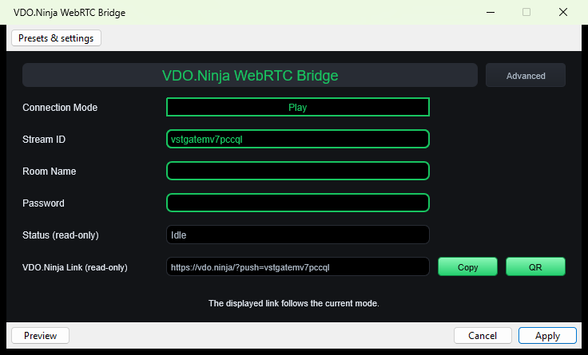

See the [packaged-release validation](../../docs/developer/RELEASE_VALIDATION_0.2.6.md)
for the exact binary hash and the measured audio checks in REAPER and the CLI host.

## Windows and Linux v0.2.8

These captures use the downloaded release packages. Linux applications ran
on an isolated X11 desktop under Ubuntu 24.04 / WSL, with synthetic audio.
REAPER used Dummy Audio and a muted master output. Audacity checks cover
editor opening/closing; they do not certify its audio processing.

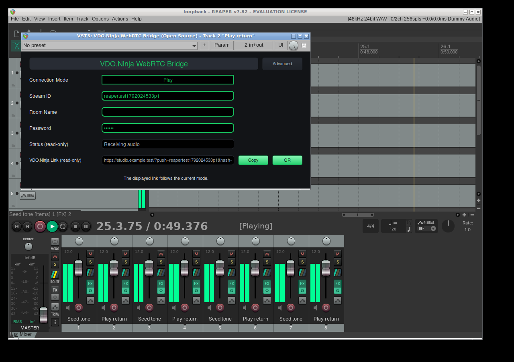

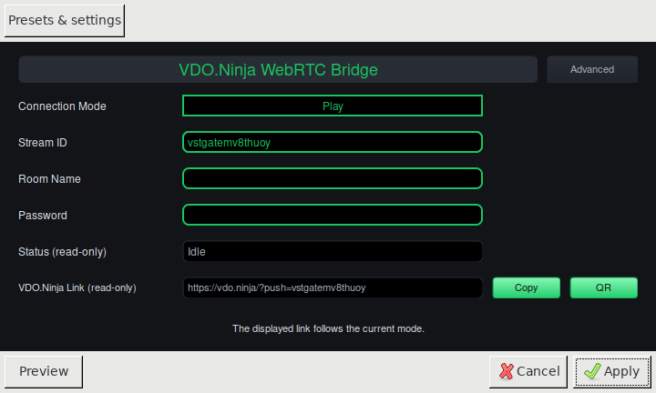

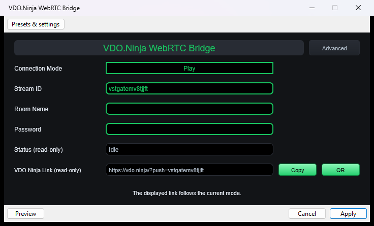

[Short Linux REAPER editor recording](linux-reaper-v0.2.8.mp4) (8 seconds, silent).

See the [release validation report](../../docs/developer/RELEASE_VALIDATION_0.2.8.md)
for package hashes, measured audio results and host-test scope.

## Reproduce native-host captures

Build `webrtc_vst_windows_editor_test`, then run:

```powershell
python scripts/capture_windows_gallery.py --ffmpeg C:/path/to/ffmpeg.exe
```

For FFmpeg builds that include OpenH264 instead of x264, add `--encoder libopenh264`.

For screenshots alone, the host accepts the bundle and output directory:

```powershell
build/webrtc_vst_win/bin/Release/webrtc_vst_windows_editor_test.exe `
  build/webrtc_vst_win/VST3/Release/webrtc_vst.vst3 media/gallery
```

An interactive Windows desktop is required. The native-host script captures
only editor pixels; it does not record the desktop, microphone, or other
applications. Ableton screenshots were captured separately during host testing.
